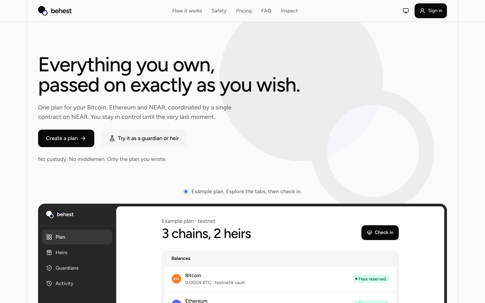
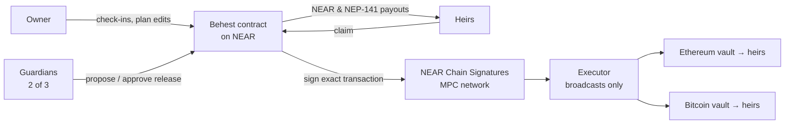

# Behest

**Non-custodial crypto inheritance across Bitcoin, Ethereum and NEAR, enforced by one NEAR contract and NEAR Chain Signatures.**

You write the plan once: who inherits, how much, on which chain, and who confirms you're gone. If you stop checking in, your guardians can start a release; you can cancel it until the very last moment; then every heir receives exactly their share, on every chain, with nobody in between holding the keys.

**Live app:** [behest.vercel.app](https://behest.vercel.app) (NEAR testnet, Sepolia, Bitcoin testnet4) · **Contract:** [`behest-ekkr6.testnet`](https://testnet.nearblocks.io/address/behest-ekkr6.testnet)



> Testnet only. Unaudited. Never use real funds.

## Try it in five minutes

1. Open **[behest.vercel.app/try](https://behest.vercel.app/try)** and press **Create my test personas**. You get six real testnet accounts with a funded plan: the owner (Kemi), three guardians and two heirs (Amara and Tobi). Their keys are generated in your browser and never leave it. No wallet needed.
2. The demo contract's timers run in minutes, so just let the owner go overdue (or play Kemi and check in to see the clock reset).
3. Switch to a guardian: propose the release, then approve it as a second guardian.
4. Switch to an heir after the waiting period: claim, and watch the share arrive.
5. Anyone can read any plan in plain words at `/plan/<owner>?view=inspect`, or the whole contract at [/inspect](https://behest.vercel.app/inspect).

Or create a real plan at [/setup](https://behest.vercel.app/setup): sign in with an **email address**, a NEAR wallet, or MetaMask. Behest pays the NEAR gas.

## The problem

When someone dies or becomes incapacitated, their crypto usually dies with them: a seed phrase in a drawer is either never found or a theft waiting to happen. The existing options all ask you to trust someone: a custodian, an exchange, a lawyer with your keys, or a single-chain "dead man's switch" that one compromised key can trigger.

## How Behest works



1. **One plan, every chain.** NEAR and NEAR tokens sit in the contract's escrow. ETH, ERC-20s and Bitcoin stay on their own chains, in vault addresses derived for your plan through **Chain Signatures**: only the contract can ask the MPC network to sign for them, and it only asks for the exact transfers your plan allows. No bridges, no wrapped assets, no custodian.
2. **"Unreachable", not "dead".** A missed check-in means only that you're unreachable. After a grace period, guardians may *propose* a release; a quorum must approve; then a waiting period runs, during which one check-in from you cancels everything.
3. **Guardians decide when, never where.** They can only approve the plan exactly as written, to your heirs' fixed addresses. A guardian who goes quiet is replaced by a standby; the quorum never drops.
4. **Heirs receive exactly their share.** Every amount is snapshotted at approval. Failed transfers are retried without ever paying twice; a reverted Ethereum transfer is re-issued only after a Merkle-Patricia proof against the Ethereum light client on NEAR.

## What makes it different

- **Heirs and guardians by email, no wallet needed.** Name someone by email address. Behest gets them Ethereum, NEAR and Bitcoin wallets (via Privy) before they ever sign in; they get an email when they're needed, sign in with a six-digit code, approve or claim, and can send what arrived to any address on any of the three chains, all from the same screen. The contract still decides when and how much.
- **No gas for the people who matter.** A relayer sponsors NEAR gas (NEP-366 meta-transactions) for check-ins, guardian votes and claims, and email and Ethereum-wallet users act through signed `personal_sign` messages the contract verifies itself; plan storage is sponsored too.
- **Edit notice.** Changes to heirs, addresses and guardians can wait out a notice period while everyone on the plan is told, so a stolen key can't quietly rewrite your plan.
- **Private heirs.** Heirs can be sealed as SHA-256 commitments on-chain and revealed only once the owner is overdue.
- **DAOs in every role.** A SputnikDAO can own a plan, guard one or inherit, through ordinary proposals.
- **NEAR Intents.** Heirs can receive into their Intents account and swap to almost any asset.
- **Destination proofs.** Heirs can prove they control each registered address (NEAR call, EIP-191, BIP-137), and ask the owner to approve a new one.
- **Plain words everywhere.** Every plan has a module-by-module summary of what each rule means, with warnings for risky combinations, and a printable recovery packet per heir.
- **Notifications** by email, Telegram and signed webhooks, from a read-only watcher that holds no keys.

## Built on NEAR

| NEAR technology | How Behest uses it |
|---|---|
| **Chain Signatures** (`v1.signer-prod.testnet`) | Per-plan Ethereum and Bitcoin vaults; the contract builds each transaction and requests the MPC signature only for transfers the plan allows |
| **Meta-transactions** (NEP-366) | Gas-free check-ins, guardian votes and claims through a role-checked relayer |
| **Ethereum-implicit accounts** | MetaMask and email users act as `0x…` NEAR accounts via signed messages (`evm_call`) |
| **NEP-141 tokens** | wNEAR and USDC escrow, registration handled by the contract |
| **NEAR Intents** | Heirs receive into their Intents account; on mainnet, swaps and plan fees in almost any asset through 1Click |
| **SputnikDAO v2** | DAOs as owners, guardians and heirs |
| **Ethereum light client on NEAR** | Proves a Sepolia transfer reverted before it is re-issued |
| **NEP-413** | Signed notification preferences, no transaction needed |

## Proven live on testnet

Every flow has a live end-to-end scenario against the deployed contract, with real Sepolia and Bitcoin testnet4 transactions. Highlights (transaction links in [docs/engineering.md](docs/engineering.md#testnet-deployment-and-live-e2e)):

- Two heirs receiving ETH and WETH from MPC-signed Sepolia transactions, surviving a 60 s executor outage.
- A Bitcoin testnet4 release paying a Taproot and a SegWit heir with chained, MPC-signed transactions.
- A reverted Sepolia transfer proven against the Ethereum light client and re-issued.
- A whole plan run by throwaway MetaMask-style keys that never held NEAR.
- DAOs as owner, guardian and heir; private heirs revealed and redistributed; guardian standbys swapped in.
- People named by email: a guardian released and an heir claimed using only their inbox, then sent NEAR, Sepolia ETH and testnet BTC onward.

**Tests:** 555 automated tests pass: contract 259 (Rust), executor 63, relayer 42, notifier 101, web 90.

## Architecture

| Path | What |
|---|---|
| [`contracts/behest/`](contracts/behest) | The Rust NEAR contract (near-sdk 5): plans, check-ins, guardians, releases, escrow, Chain Signatures transaction building for Ethereum and Bitcoin |
| [`apps/web/`](apps/web) | Next.js app: landing, plan wizard, owner/guardian/heir views, public inspector, Try-as sandbox |
| [`services/relayer/`](services/relayer) | Gas relayer: sponsors allowlisted calls only for accounts that hold that role in the plan |
| [`services/executor/`](services/executor) | Broadcasts contract-signed Ethereum and Bitcoin transactions and reports status. Holds no authority; anyone can run one |
| [`services/notifier/`](services/notifier) | Read-only watcher that sends email, Telegram and webhook notices; names people by email |
| [`tools/testnet/`](tools/testnet) | Deploy scripts and the live end-to-end scenarios |
| [`docs/spec/`](docs/spec) | Specification: state machine, permissions, signing boundary, schema, threat model (70 threats), decisions (D1–D34) |
| [`docs/engineering.md`](docs/engineering.md) | Full engineering reference: configuration, every live run with transaction links, progress |

**Trust model:** the contract authorizes everything. The relayer can only waste its own gas, the executor can only broadcast what the contract signed, and the notifier can only read. None of them can start a release or redirect a share.

## Run it locally

Requirements: Node.js (production runs Node 26), pnpm 9, Rust with `cargo-near` (only to build the contract).

```sh
pnpm install
cp .env.example .env                     # fill in what you need; the web app runs against the live testnet contract

pnpm --filter @behest/web dev            # http://localhost:3000
pnpm --filter @behest/relayer start      # sponsored gas (needs RELAYER_ACCOUNT_ID / RELAYER_PRIVATE_KEY)
pnpm --filter @behest/notifier start     # notices (optional)

pnpm test                                # every TypeScript suite
(cd contracts/behest && cargo test)      # contract tests
```

Deploying your own contract and running the live scenarios is covered in [docs/engineering.md](docs/engineering.md#testnet-deployment-and-live-e2e).

## Limits, honestly

- Testnet only, unaudited, and the contract is still upgradeable by its admin.
- Behest can't know that someone died; it only knows check-ins stopped. Pair it with legal estate planning.
- People named by email depend on their inbox and on Privy for their keys. Heirs with their own wallet depend on neither.
- On testnet, NEAR Intents is a mock verifier; the real `intents.near`, bridge and 1Click are mainnet-only and untested.
## License

[MIT](LICENSE)
